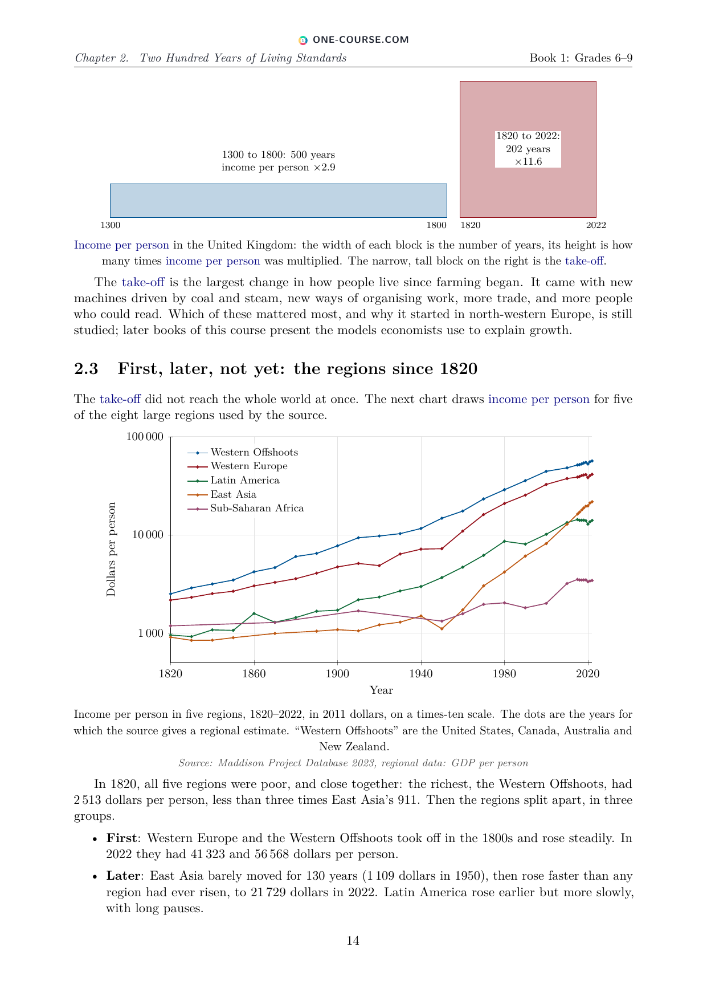
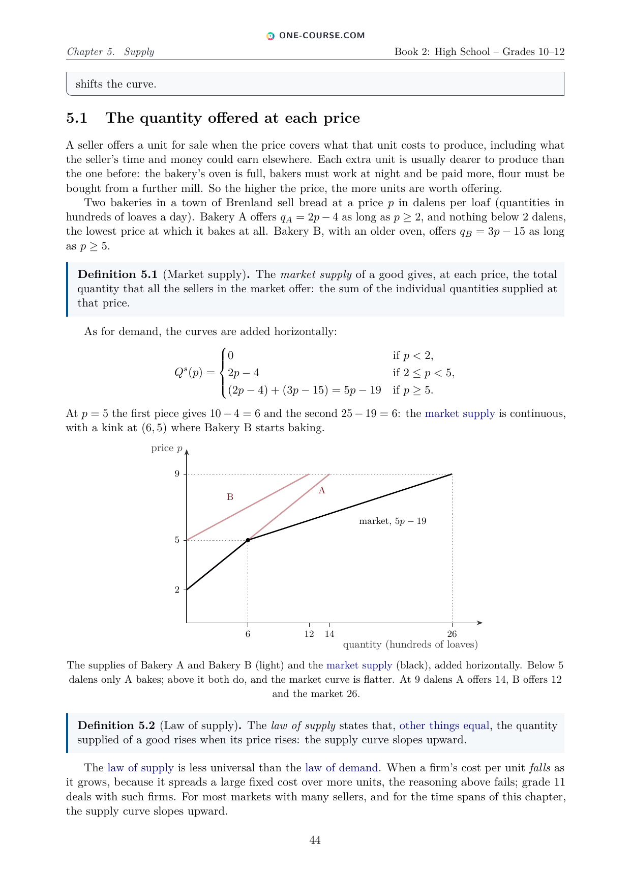
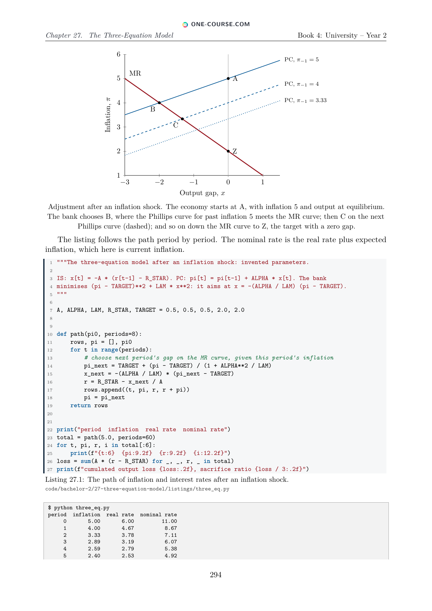

# One Economics Book

<p align="center">
  <a href="https://one-course.com">
    
  </a>
</p>

<p align="center">
  <a href="https://github.com/bvirrion/one-economics-book/releases/latest"></a>
  <a href="https://github.com/bvirrion/one-economics-book/releases"></a>
  <a href="https://github.com/bvirrion/one-economics-book/actions/workflows/release.yml"></a>
  <a href="https://one-course.com/books"></a>
</p>

*The One Economics Book to Rule Them All.*

> **One Economics Book** is part of the **One Course** project — one coherent
> course covering each subject from kindergarten to the end of the
> bachelor's degree. Discover the whole project at
> **[one-course.com](https://one-course.com)**, and see the siblings
> [One Math Book](https://github.com/bvirrion/one-math-book),
> [One Physics Book](https://github.com/bvirrion/one-physics-book),
> [One Chemistry Book](https://github.com/bvirrion/one-chemistry-book),
> [One Biology Book](https://github.com/bvirrion/one-biology-book),
> [One Earth and Space Sciences Book](https://github.com/bvirrion/one-earth-and-space-sciences-book),
> [One Computer Science Book](https://github.com/bvirrion/one-computer-science-book) and
> [One Quant Book](https://github.com/bvirrion/one-quant-book).

A series of five **free economics textbooks** forming a single coherent
course **from Grade 6 to the end of the bachelor's degree** — one notation,
one voice, every year building on the previous one. The books are written in
**English**. Whether you are a student, a parent, a teacher or a homeschooling
family, you can read every book online or download the PDF — free of charge:

1. **Middle School Economics** — Grades 6–9;
2. **High School Economics** — Grades 10–12;
3. **University Economics — Year 1**;
4. **University Economics — Year 2**;
5. **University Economics — Year 3**.

The course puts **the facts first, then the models that work**. Every chapter
opens with a chart of real data, and every model is presented in the same
frame: what it **assumes**, what it **predicts**, where it was **tested**, and
where it **breaks**. Questions the evidence leaves open are marked as such,
and the course describes how economies work; it does not tell the reader what
policy to prefer.

The style is concise and rigorous: courses built from **definitions,
examples, propositions and methods**, followed by graded **exercises and a
weekend problem with full solutions** collected at the end of each book.

- **Charts redrawn from public data.** Every chart is drawn by a tested
  script from data published by official providers (World Bank, OECD,
  national statistics offices and others), with the source printed under it.
- **Sourced numbers.** Every published figure quoted in a book goes through a
  ledger that names its source.
- **Python from Year 1.** The university books use Python for data and
  econometrics; every listing is included from a tested file, and every
  printed output is what the program really printed.
- **Invented countries to practise on.** Exercises use two invented
  countries, Brenland and Kestria, whose data are generated by code, so every
  computation has an exact answer.

Thousands of generated hyperlinks send every defined term back to its
definition, and every exercise to its solution.

<p align="center">
  
  
  
</p>
<p align="center"><sub>Three pages: living standards since 1820 (Book 1), market supply (Book 2), the three-equation model (Book 4).</sub></p>

## Read online · Download the PDFs

| Book | Read online | Download PDF |
|------|-------------|--------------|
| **1. Middle School** (Grades 6–9) | [EN](https://one-course.com/books/economics/1/en) | [EN](https://github.com/bvirrion/one-economics-book/releases/latest/download/one_economics_book_1_middle_school.pdf) |
| **2. High School** (Grades 10–12) | [EN](https://one-course.com/books/economics/2/en) | [EN](https://github.com/bvirrion/one-economics-book/releases/latest/download/one_economics_book_2_high_school.pdf) |
| **3. University — Year 1** | [EN](https://one-course.com/books/economics/3/en) | [EN](https://github.com/bvirrion/one-economics-book/releases/latest/download/one_economics_book_3_university_year_1.pdf) |
| **4. University — Year 2** | [EN](https://one-course.com/books/economics/4/en) | [EN](https://github.com/bvirrion/one-economics-book/releases/latest/download/one_economics_book_4_university_year_2.pdf) |
| **5. University — Year 3** | [EN](https://one-course.com/books/economics/5/en) | [EN](https://github.com/bvirrion/one-economics-book/releases/latest/download/one_economics_book_5_university_year_3.pdf) |

Every book can be read online, chapter by chapter, and the PDF links always
point at the newest release. Spotted a mistake in any book? Please
[report an erratum](https://github.com/bvirrion/one-economics-book/issues/new?template=errata.yml) —
fixes usually ship within days.

## Current status

**All five books are written**, in English: 172 chapters in all.

| Book | Level | Status |
|------|-------|--------|
| Middle School | Grades 6–9 (age 11–15) | ✅ 30 chapters, 360 exercises, 30 weekend problems, solutions — about 280 pages |
| High School | Grades 10–12 (age 15–18) | ✅ 40 chapters, 600 exercises, 40 weekend problems, solutions — about 415 pages |
| University — Year 1 | Bachelor Year 1 (age 18–19) | ✅ 32 chapters, 384 exercises, 32 weekend problems, solutions — about 395 pages |
| University — Year 2 | Bachelor Year 2 (age 19–20) | ✅ 34 chapters, 408 exercises, 34 weekend problems, solutions — about 455 pages |
| University — Year 3 | Bachelor Year 3 (age 20–21) | ✅ 36 chapters, 432 exercises, 36 weekend problems, solutions — about 470 pages |

## Building the books

Requirements: TeX Live 2026 with `latexmk` (packages used: `tcolorbox`,
`pgfplots`, `listings`, `siunitx`, `cleveref`, `imakeidx`, …), and for the
code Python 3.12.

```sh
make                # or just: latexmk — builds all five books into build/
make venv           # create .venv (pandas, statsmodels, pytest, ruff)
tools/test_code.sh  # every listing, every printed output, every test
make figdata        # redraw every chart's data from the derived tables
```

The PDFs are produced at `build/one_economics_book_<N>_<slug>.pdf`, with
`N` = 1–5 and `slug` ∈ {`middle_school`, `high_school`, `university_year_1`,
`university_year_2`, `university_year_3`}. To build a single book, e.g.
`latexmk one_economics_book_2_high_school.tex`.

## Repository layout

```
one_economics_book_<N>_*.tex   entry file per book (N = series number)
styles/oneeconomics.sty        packages, environments, macros, model and chart boxes
styles/lang/<lang>.tex         UI strings
frontmatter/                   title page, preface (shared layout)
parts/<year>/part.tex          shared structure for a year
parts/<year>/NN-*.tex          chapter
parts/<year>/solutions/        solutions
figdata/                       the scripts behind every chart, with their tests
data/                          the datasets' manifest and the tables derived from them
code/<year>/, code/shared/     the programs the chapters print, and the invented country
sources/                       the ledger of published numbers
tools/                         data fetcher, code tests, gates, HTML reader converter
```

## Contributing

Contributions are welcome — corrections, better charts, additional exercises, new chapters. Please read
[CONTRIBUTING.md](CONTRIBUTING.md) for the structure, environments and
style conventions of the project. The fastest way to help is to
[report an erratum](https://github.com/bvirrion/one-economics-book/issues/new?template=errata.yml)
when you spot a mistake.

## Contributors

- Benjamin Virrion
- Claude (Anthropic)

## License

- **How to credit**: One Economics Book, One Course (one-course.com).
- **Book content** — the LaTeX sources, figures, and the PDF and HTML editions — is licensed under
  [Creative Commons Attribution-NonCommercial-ShareAlike 4.0](https://creativecommons.org/licenses/by-nc-sa/4.0/)
  (CC BY-NC-SA 4.0): you may share and adapt it, including translating it, with credit to
  One Economics Book, for non-commercial purposes, and adaptations must use the same licence. See [`LICENSE`](LICENSE).
- **Software** — `code/`, `tools/`, `.github/`, the `Makefile` and the build scripts — is licensed under the MIT licence: see [`LICENSE-CODE`](LICENSE-CODE).
- **Third-party material** (photographs, public-domain images, bundled fonts) keeps its own licence, as listed in
  the books' image-credit pages.
- **Names and logos**: "One Course" and "One Economics Book" are not covered by these licences.
- **Commercial use** (print editions, licences for schools, publishers or companies): contact One Course via [one-course.com/contact](https://one-course.com/contact).

Contributions are accepted under these licences with a signed-off commit — see
[`CONTRIBUTING.md`](CONTRIBUTING.md#licensing-of-contributions).
